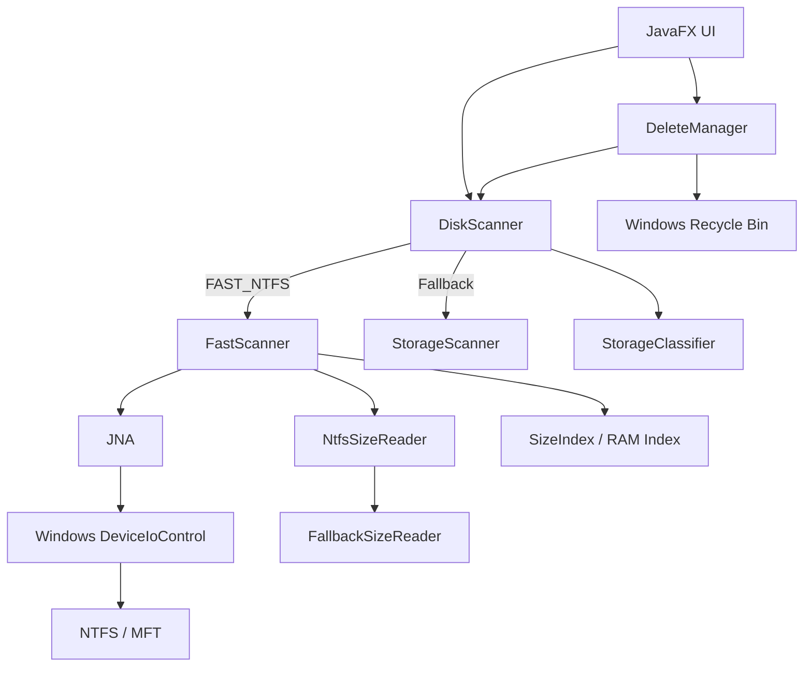

[README.md](https://github.com/user-attachments/files/31042010/README.md)
# DiskScope

A fast Windows storage analyzer built with **Java 21, JavaFX, JNA, and NTFS metadata scanning**.

DiskScope scans a Windows drive, shows where storage is being used, identifies large files and cleanup candidates, protects critical system files, and safely moves deletions to the Windows Recycle Bin.

The project started as a normal recursive Java filesystem scanner, but was redesigned around the **NTFS Master File Table (MFT)** after performance became a major bottleneck.


---

## Why I Built It

The first version of DiskScope used normal recursive Java filesystem traversal. It worked, but scanning a drive containing hundreds of thousands of directories took roughly **12 minutes**.

Instead of trying to micro-optimize recursive traversal, I redesigned the scanner around NTFS metadata.

The final architecture reads the NTFS **Master File Table**, reconstructs paths from file and parent references, extracts logical file sizes directly from NTFS records, and builds an in-memory index for fast browsing.

Representative development performance:

```text
Recursive Java scanner
        ↓
~12 minutes

NTFS / MFT scanner
        ↓
~9–10 seconds initial indexing

After indexing
        ↓
RAM-backed folder browsing
        ↓
Near-instant
```

That is roughly a **75x improvement** for the initial full-drive scan on the development machine.

> Performance varies depending on hardware, drive contents, MFT size, and system load.

---

## Features

- Fast NTFS/MFT drive scanning
- Java fallback scanner when raw NTFS access is unavailable
- RAM-backed folder browsing after indexing
- Folder-size aggregation
- Largest-files view
- Live multi-term filtering by name, path, category, and recommendation
- CSV export of the currently visible, filtered results
- Cleanup recommendations
- Storage classification
- Protected Windows system paths
- Breadcrumb folder navigation
- Drive usage dashboard
- Background scanning so the JavaFX UI stays responsive
- Refresh and full rescan support
- Safe deletion through the Windows Recycle Bin
- Confirmation dialog before destructive actions
- Protected files never receive an enabled delete action

---

## Screenshots

### Main Interface


### Storage / Cleanup View


### Additional View


---

## Architecture



`DiskScanner` acts as the scanner facade, so the UI does not need to know whether data came from the optimized NTFS scanner or the recursive Java fallback.

---

## Fast NTFS Scanner

The optimized pipeline is:

```text
JavaFX
  ↓
DiskScanner
  ↓
FastScanner
  ↓
JNA
  ↓
Windows kernel32.dll
  ↓
DeviceIoControl
  ↓
NTFS MFT / USN metadata
```

DiskScope opens the Windows volume, for example:

```text
\\.\C:
```

It then uses Windows filesystem control operations to enumerate NTFS metadata instead of recursively opening every folder.

Important operations include:

```text
FSCTL_QUERY_USN_JOURNAL
FSCTL_ENUM_USN_DATA
FSCTL_GET_NTFS_VOLUME_DATA
FSCTL_GET_NTFS_FILE_RECORD
```

DiskScope decodes file IDs, parent IDs, names, attributes, and logical sizes, then reconstructs paths from MFT parent relationships.

---

## NTFS File Size Resolution

DiskScope retrieves NTFS file records and parses the unnamed `$DATA` attribute to determine logical file size.

Some files store attributes in additional MFT segments. For those, DiskScope follows `$ATTRIBUTE_LIST` references to locate the record containing the file's data attribute.

A small Java NIO fallback using `Files.size(...)` handles the remaining uncommon cases.

Representative development results:

```text
~690,000 files
        ↓
Most sizes resolved directly from NTFS records
        ↓
~23,000 additional files resolved through $ATTRIBUTE_LIST
        ↓
~2,000 uncommon cases
        ↓
Files.size() fallback
        ↓
0 missing sizes
```

---

## RAM-Backed Browsing

After the initial scan, DiskScope builds in-memory indexes for parent/child relationships, path-to-directory lookup, and aggregated folder sizes.

That means opening folders after indexing does not require another recursive scan.

---

## Fast Scanner + Fallback Architecture

DiskScope keeps the original Java scanner as a compatibility path.

```text
DiskScope starts
        ↓
Try FAST_NTFS
        ↓
Raw NTFS access available?
        │
        ├── YES → FastScanner → RAM-backed browsing
        │
        └── NO  → StorageScanner → Java traversal
```

---

## Safety Model

DiskScope separates **disk accounting** from **cleanup recommendations**.

Protected files remain in the internal index so storage totals are accurate, but they are not presented as normal cleanup candidates.

Examples include:

```text
C:\Windows
C:\Program Files
C:\Program Files (x86)
C:\ProgramData
C:\Recovery
C:\System Volume Information

pagefile.sys
hiberfil.sys
swapfile.sys
```

---

## Storage Classification

DiskScope classifies files and folders into categories such as:

```text
USER_DATA
APPLICATION
DEV_TOOL
TEMPORARY_DATA
PROTECTED_SYSTEM
RECYCLE_BIN
UNKNOWN
```

These categories are used to decide whether something can be reviewed, cleaned, requires confirmation, or must remain protected.

---

## Safe Deletion

DiskScope does not permanently erase files directly.

Deletion uses the **Windows Recycle Bin**.

Before deletion, the JavaFX UI shows a confirmation dialog containing the file/folder name, full path, size, and storage classification.

Protected system items cannot reach the destructive action.

---

## Scanner Modes

### FAST_NTFS

Uses direct NTFS volume metadata.

Advantages:

- fast initial indexing
- no repeated recursive traversal
- RAM-backed folder navigation
- efficient largest-file queries

Administrator privileges are normally required because Windows restricts direct volume access.

### JAVA_FALLBACK

Uses the original recursive Java scanner.

It is slower, but keeps DiskScope usable when raw NTFS access is unavailable.

---

## Performance Summary

| Operation | Time |
|---|---:|
| Original recursive full-drive scan | ~12 minutes |
| Raw MFT enumeration | ~4–6 seconds |
| NTFS file-size processing | ~3–4 seconds |
| Folder-size RAM aggregation | ~0.4–0.6 seconds |
| ~2,000-file Java fallback | ~0.2 seconds |
| Complete optimized initial scan | ~9–10 seconds |
| Folder browsing after indexing | Near-instant |

**Approximate initial scan speedup: ~75x**

---

## Tech Stack

### Backend
- Java 21
- Windows NTFS
- Master File Table
- USN metadata
- Windows `DeviceIoControl`
- JNA / JNA Platform
- Java NIO
- Maven

### Frontend
- JavaFX

---

## Main Components

| Class | Responsibility |
|---|---|
| `DiskScanner` | Scanner facade and FAST_NTFS / fallback selection |
| `FastScanner` | NTFS volume access and MFT enumeration |
| `NtfsSizeReader` | Reads logical file sizes from NTFS records |
| `FallbackSizeReader` | Resolves uncommon remaining file sizes |
| `SizeIndex` | Aggregates folder sizes and builds RAM indexes |
| `StorageScanner` | Original recursive Java fallback scanner |
| `StorageClassifier` | Classifies files and folders |
| `DeleteManager` | Safe deletion handling |
| `DiskScopeApp` | JavaFX application entry point |
| `MainView` | Main JavaFX interface |
| `DriveOverviewPane` | Drive storage statistics |

---

## Requirements

- Windows 10 / 11
- Java 21
- Maven
- NTFS drive recommended
- Administrator privileges recommended for `FAST_NTFS`

---

## Running DiskScope

```powershell
git clone https://github.com/FuriousRec/DiskScope.git
cd DiskScope
mvn javafx:run
```

For fast NTFS scanning, run:

```text
Run-DiskScope-Admin.bat
```

A successful native scan displays `FAST_NTFS`. If raw volume access fails, DiskScope switches to the Java fallback scanner.

---

## Building

```powershell
mvn clean compile
mvn clean package
```

---

## Testing

The test suite exercises the in-memory `SizeIndex` without requiring NTFS
access. It covers normal ancestor aggregation, corrupt parent cycles, unresolved
file sizes, bounded largest-file selection, the headless result-filtering
logic, and safe CSV export used by the JavaFX interface. CSV tests cover
quoting, Unicode, UTF-8 output, and spreadsheet-formula neutralization.
Windows-specific tests also verify that
cleanup classifications match complete path segments and do not mistake
lookalike names such as `DownloadsBackup` for known locations.

```powershell
mvn verify
```

GitHub Actions compiles the application and runs the tests on Java 21 on both
Ubuntu and Windows for every push and pull request. Native NTFS access still
requires Windows and is outside this unit-test suite.

---

## Engineering Challenges

- calling native Windows APIs from Java
- decoding binary NTFS records
- reconstructing full paths from MFT parent relationships
- handling NTFS root-record behavior
- parsing `$DATA`
- following `$ATTRIBUTE_LIST` extension records
- handling uncommon MFT records with a fallback strategy
- aggregating hundreds of thousands of files into folder totals
- preventing expensive recursive fallback scans from accidentally running during fast mode
- invalidating the active index after deletion
- separating filesystem accounting from cleanup safety

---

## Limitations

- Optimized scanning is Windows/NTFS-specific.
- Administrator privileges may be required for direct volume access.
- Benchmark results vary between systems.
- DiskScope currently reports **logical file size**, which may differ from physical allocated size for compressed or sparse files.
- The fallback scanner is significantly slower than the NTFS scanner.

---

## Future Ideas

- incremental updates using the USN Journal
- persistent scan cache
- duplicate-file detection
- file-extension statistics
- physical allocated-size calculation
- sparse/compressed-file analysis
- multi-drive indexing
- background filesystem change monitoring

---

## License

This project is licensed under the MIT License.
